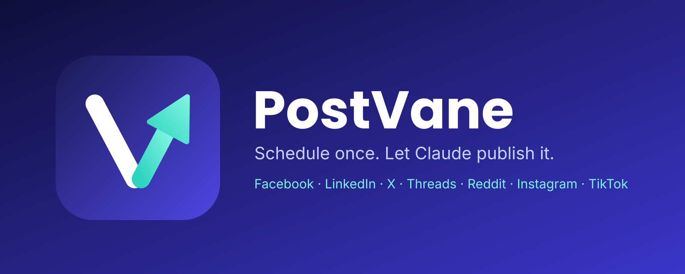

# PostVane

[](https://github.com/nurulislamtask/PostVane/actions/workflows/build.yml)
[](LICENSE)




A local social media post scheduler for Facebook, LinkedIn, X, Threads, Reddit, Instagram and TikTok. You write and schedule posts in a React dashboard. At post time, a local
worker opens **your own Chrome** (one saved login per account) and an **AI model of your choice** reads the page and clicks and types,
the way you would by hand.

- **Free to run.** Use OpenRouter or Google Gemini (both have free models), Ollama on your own computer, OpenAI, Groq or any
  OpenAI-compatible URL. You can add several and switch in Settings. No paid Claude plan needed.
- **Or use Claude Code.** If you have a Claude Pro or Max plan, pick the "Claude Code" engine in Settings and posts go through Claude in Chrome instead.
- No Graph API, Meta, X, LinkedIn, Reddit or TikTok API. Your passwords never leave your Chrome profile.

```
Dashboard (React) → Express API → SQLite → worker (every 60s) → AI model ⇄ your Chrome → the social network
```

## AI providers

Open **Settings → AI engine → Add provider**, pick a provider, paste its key, press **Fetch models**, choose one and press **Test**.

| Provider | API URL | Key |
|---|---|---|
| OpenRouter | `https://openrouter.ai/api/v1` | [openrouter.ai/keys](https://openrouter.ai/keys) |
| Google Gemini | `https://generativelanguage.googleapis.com/v1beta/openai` | [aistudio.google.com/apikey](https://aistudio.google.com/apikey) |
| Ollama | `http://127.0.0.1:11434/v1` | none |
| OpenAI / Groq / others | their OpenAI-compatible URL | their key |

**Many models, many keys.** Add as many as you like at once: pick several models, paste several keys (one per line) and PostVane makes one entry
for every model and key. With OpenRouter, tick **Show free models only** and **Select all free models**.
- **Take turns** (default): each post starts with the model used longest ago, so the free limits of all of them are spread out.
- **Use the first one until it runs out:** always the first model that isn't resting.

When a model hits its limit (or its key is refused) PostVane rests it, 15 minutes for a rate limit, a few hours for a daily quota,
a day for a bad key, and carries on with the next one, even in the middle of a post. Rested models are marked in Settings
and come back by themselves (**Wake all up now** brings them back early).

Any server that speaks the OpenAI chat API works (LM Studio, vLLM, Together, your own). Keys are stored only in this computer's database.
The AI works from a text list of what is on the page, so a model does not need to see images. Stronger models post more reliably; very small ones
often get lost on Facebook. If a free model hits its limit, the worker pauses for an hour and tries again.

## Download

Get the latest builds from the [Releases page](https://github.com/nurulislamtask/PostVane/releases/latest):

| File | What it is |
|---|---|
| `PostVane-<version>-win-x64.exe` | Windows installer. Runs PostVane in a window and the system tray, so scheduled posts keep going out. |
| `PostVane-<version>-android.apk` | Android **companion app**. It opens the dashboard of the PostVane running on your computer (see below). |

Windows may show "Windows protected your PC" because the installer isn't code-signed: click **More info → Run anyway**.

### Android companion

Posts are published by Claude Code and Chrome on a computer, so the phone can't publish by itself. The app is a window
onto the dashboard running on your computer, so you can schedule and check posts from your phone.

1. Run PostVane on your computer and keep it on.
2. Start it reachable from your phone **on a private network you trust**, for example Tailscale:
   `POSTVANE_HOST=<your private address> npm start` (on Windows: set the variable first).
   The dashboard has **no login**, so never expose it to the public internet or an untrusted Wi-Fi.
3. Install the APK, open it and enter `http://<that address>:4317`.

The first-run **Setup** page walks you through the AI provider, Chrome, account logins and a test, about 5 minutes, once.

## Use it

1. **Settings:** add an AI provider (see above) and edit how the AI describes you when a group asks membership questions.
2. **Accounts:** add each social account and press **Log in**. Sign in once in the Chrome window that opens; PostVane keeps that login.
3. **Destinations:** add your profile (`https://www.facebook.com/me` works), Pages you can post as, and groups you can post in.
4. **Compose:** write text, attach photos or one video, tick destinations, pick a time.
5. **Queue:** watch each post's status and read the AI's report for any run.

## Platforms

| Platform | Destinations | Notes |
|---|---|---|
| Facebook | Profile, Pages, groups | Joins groups first if needed and answers membership questions. Each group can post as you or as one of your Pages (**Post as** in Destinations). |
| LinkedIn | Profile, company Pages, groups | Page posts go out as the Page. |
| X | Profile | Long text fails unless your account allows it; Claude never shortens it. Up to 4 photos. |
| Threads | Profile | |
| Reddit | Your profile, subreddits | The first line of the post is the title. Claude picks a flair when one is required. |
| Instagram | Profile | Needs a photo or a video. |
| TikTok | Profile | Needs a video. |

Chrome must be signed in to each account you post to. The group gap applies between group posts on the same platform.

## Statuses

| Status | Meaning |
|---|---|
| Queued | Waiting for its time, the group gap or the daily cap |
| Posting… | Claude is working in Chrome |
| Posted | Claude clicked Post and then saw the post live on the profile, Page or group. If it can't see it live, the post goes to "Needs check" instead. |
| Pending approval | Posted to a group that needs admin approval |
| Failed | Claude stopped **before** clicking Post (login wall, checkpoint, no permission). Retried once automatically. |
| Needs check | Claude may have clicked Post but the result is unclear (crash, timeout, unreadable report). **Never retried automatically.** Check Facebook, then choose "It posted" or "It didn't post — retry now". |

## Limits and risks

- **Facebook's terms restrict automated access.** Posting the same content to many groups looks like spam.
  The daily cap (default 10) and group gap (default 20 min) reduce the risk but don't remove it.
- **AI usage (Claude engine).** Each post is a full Claude Code browser session. The first test used about
  25 steps and roughly 730k tokens (mostly cached) on Sonnet, in about 2.5 minutes. That counts against your
  plan's usage limits. When a limit is hit, the worker pauses for 1 hour and requeues the post.
- **Check the terms yourself.** Make sure that running Claude Code unattended on a schedule is allowed by
  your current Claude subscription terms.
- **Media size.** With an AI provider, files go straight into your Chrome, so full videos fit. With the Claude engine, uploads go through the Claude in Chrome extension,
  whose file upload stops at 10 MB, so most phone videos won't fit.
- If the computer sleeps, Chrome is closed or Facebook logs you out, posts run late or fail and the dashboard shows it.
  CAPTCHAs and security checks are never bypassed; the post fails and you handle it.
- One Facebook login (the one in Chrome). Pages are posted to by switching into the Page.

## Development

```bash
npm test        # node:test, uses a fake claude binary — no Facebook, no usage
npm run dev     # Vite dev server on :5173, proxying to npm start on :4317
```

Data lives in `data/` (SQLite), `media/` (uploads), `jobs/` (per-run copies) and `logs/` (raw Claude output per run).

## Development

```bash
npm test        # node:test, uses a fake claude binary — no Facebook, no usage
npm run dev     # Vite dev server on :5173, proxying to npm start on :4317
npm run app     # build and open the desktop app (Electron)
```

Data lives in `data/` (SQLite), `media/` (uploads), `jobs/` (per-run copies) and `logs/` (raw Claude output per run).
The desktop app keeps the same folders in your user app-data folder. Releases are described in [docs/RELEASING.md](docs/RELEASING.md).

## Credits and license

[MIT](LICENSE). PostVane is based on [Autoposter](https://github.com/raketbizdev/autoposter) by Ruel Nopal, also MIT.
Not affiliated with, endorsed by or sponsored by Meta or Anthropic. You are responsible for
following the terms of each social network and your Claude plan when you use it.
